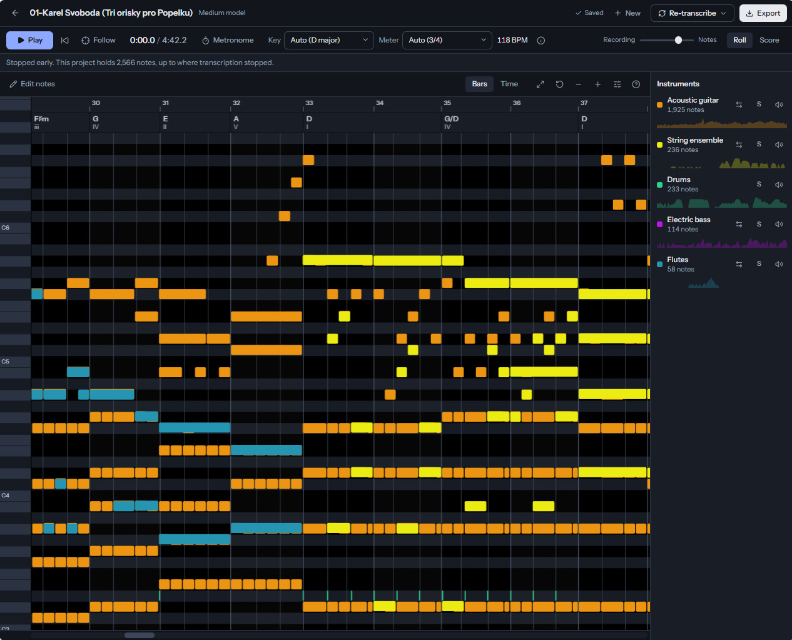
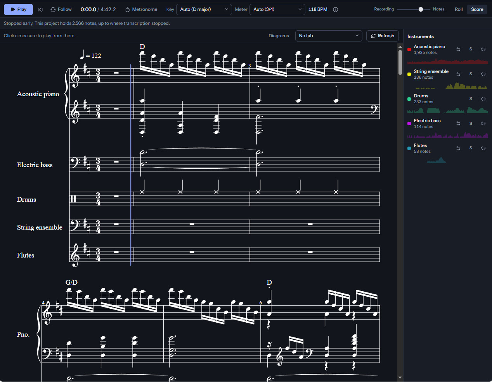
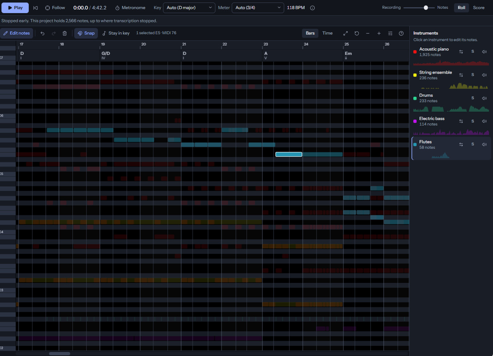
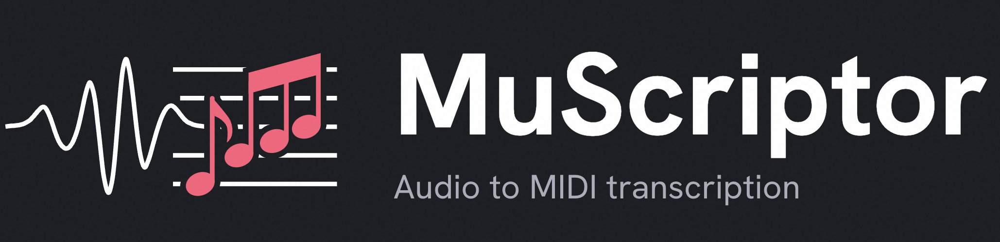

# MuScriptor Studio

Turn a recording into notes you can edit, hear and export. Drop in an audio file, and Studio writes out what each instrument plays, as MIDI, sheet music, guitar or ukulele tablature, and PDFs. It all runs on your own computer.



| Sheet music | Editing notes |
|---|---|
|  |  |

**Tested on Windows 10.** Windows only for now.

## How is this different from MuScriptor?

[MuScriptor](https://github.com/muscriptor/muscriptor) is the transcription engine, made by Kyutai and Mirelo. It listens to a recording and writes out the notes. Studio is an application built around that engine. The transcription itself is the same.

| | MuScriptor | MuScriptor Studio |
|---|---|---|
| Transcribe a recording to MIDI | Yes | Yes |
| Piano roll while it transcribes | Yes | Yes |
| Choose a model size | When starting it from the command line | On screen |
| Edit notes, with undo | | Yes |
| Change a track's instrument afterwards | | Yes |
| Keep your songs in a library | | Yes |
| Re-transcribe all or part of a song | | Yes |
| Detect which instruments play | | Yes |
| Key and chord names | | Yes |
| Sheet music on screen, following playback | | Yes |
| Guitar and ukulele tablature, with tunings and capo | Automatic, as PDF, from the command line | One chosen track, on screen and in PDF |
| Chord diagrams | | Yes |
| PDF and MusicXML with chord names | PDF and MusicXML from the command line | From the Export window |
| Installs with one double-click | | Yes |

## Install for newbs

No programming knowledge needed. You'll click through four steps. Allow **10 to 30 minutes** and **about 7 GB of free disk space**, more if you choose the Large model.

### Step 1: Get permission to download the models

The models are free for non-commercial use, but their makers ask you to accept the licence on Hugging Face.

1. Create a free account at <https://huggingface.co/join> if you don't already have one, and log in.
2. Open the page of each transcription model you want and accept its terms. It says "You need to agree to share your Hugging Face information to access this model": click the button below that text. If you're not sure which to get, use Medium:
   - Medium (highly recommended): <https://huggingface.co/MuScriptor/muscriptor-medium> works fast and reliable on < 3GB GPU.
   - Small, for computers without an NVIDIA graphics card: <https://huggingface.co/MuScriptor/muscriptor-small>
   - Large, only with > 12 GB of graphics memory: <https://huggingface.co/MuScriptor/muscriptor-large> 
3. Open <https://huggingface.co/settings/tokens> and click **Create new token**. Choose the type **Read**, give it any name, and click **Create token**.
   (You can also download it directly instead of letting the install download it using token.) 
4. Click **Copy**, and keep that page open. You'll paste this token in Step 3.

### Step 2: Download Studio

1. Open <https://github.com/FartyPants/muscriptor-studio>.
2. Click the green **Code** button, then **Download ZIP**.
3. Open your Downloads folder, right-click `muscriptor-studio-main.zip`, and choose **Extract All...**
4. In the box that asks where to extract, replace the text with exactly this:

   ```
   C:\
   ```

5. Click **Extract**. You now have the folder `C:\muscriptor-studio-main`.

Use that folder, not your Desktop or Documents. Those are often synced to OneDrive, and the install is too large for that. A very long folder path also makes the install fail.

### Step 3: Install

1. Open `C:\muscriptor-studio-main` and double-click **install.bat**.
2. If Windows says "Windows protected your PC", click **More info**, then **Run anyway**.
3. A black window opens. It asks:

   ```
   Models to download [medium tagger]:
   ```

   Press **Enter** to get the recommended ones. Or type the names you want from the table below, with spaces between them, and press **Enter**.
4. It then asks for your token:

   ```
   Paste your token and press Enter (leave empty to skip):
   ```

   Right-click in the black window to paste the token from Step 1, then press **Enter**.
5. Leave the window open while it downloads everything. You can do other things meanwhile. When it says `Done. Start MuScriptor Studio with start-studio.bat`, press any key to close it.

| Type this | Model | Download | Graphics memory (GPU) | Good for |
|---|---|---|---|---|
| `small` | Small | 0.4 GB | 1.5 GB | Computers without an NVIDIA graphics card |
| `medium` | Medium (recommended) | 1.2 GB | 3 GB | Most computers |
| `large` | Large | 5.5 GB | 12 GB | Most accurate, needs a powerful graphics card |
| `tagger` | Instrument detection | 0.3 GB | | The **Detect instruments** button |

Not sure about your graphics card? Press **Ctrl + Shift + Esc**, click **Performance**, then **GPU**: its name is at the top right. Studio finds an NVIDIA card by itself. Without one it uses the processor, which is much slower, so choose `small`.

### Step 4: Start Studio

Double-click **start-studio.bat** in the same folder. Your browser opens Studio by itself. The first start can take a minute.

Keep the black window open while you use Studio. Closing it stops Studio.

## If something goes wrong

Most problems are fixed by running **install.bat** again: it skips what's already done.

| You see | What to do |
|---|---|
| `Install stopped while ...` | Check your internet connection, then double-click install.bat again. |
| `MuseScore could not be unpacked` | The folder path is too long. Move the folder to `C:\` as in Step 2, and run install.bat again. |
| `not allowed yet. Accept its licence at ...` | Open the link it shows, accept the terms as in Step 1, and run install.bat again. |
| `Some downloads are unfinished` | Fix what's listed above that line, and run install.bat again. |
| `No models are installed yet` (in the browser) | Run install.bat and choose at least one model. |
| `Another MuScriptor server is using port 8222` | Close the other black window, then start Studio again. |
| `The MuScriptor server isn't responding` (in the browser) | Double-click start-studio.bat, and keep its window open. |

## Moving to another computer

1. Do Step 2 on the new computer, then Step 3, and type `none` when it asks for models.
2. Copy the `models` folder from the old computer into the new `C:\muscriptor-studio-main`, replacing what's there.
3. To bring your songs too, copy `studio\data` the same way.

## Updating

Download the new ZIP as in Step 2, and extract it to a new folder. Copy `models` and `studio\data` into it from the old folder, and run install.bat there. Then you can delete the old folder.

## Uninstalling

Delete the folder. That removes everything: Studio, its Python, MuseScore, the models and your songs.

## Where things are kept

Everything stays in this one folder. Nothing is added to the Windows app list or to Program Files.

| Folder | What's in it |
|---|---|
| `.tools` | The tools Studio needs, including MuseScore and your Hugging Face login |
| `.venv` | Python's packages |
| `models` | The models |
| `studio\data` | Your songs |

If MuseScore 4 was already installed on your computer, Studio uses that copy and leaves it as it is.

## Licences

The transcription models are [CC BY-NC 4.0](https://creativecommons.org/licenses/by-nc/4.0/): **non-commercial use only**. The instrument detection model is BSD-3-Clause. The code is MIT licensed, and MuScriptor is by Kyutai and Mirelo.

## For developers: manual install

Everything install.bat does, by hand. Open the folder in File Explorer, click the address bar, type `cmd` and press Enter. These commands are for Command Prompt, not PowerShell.

```bat
git clone https://github.com/FartyPants/muscriptor-studio C:\MuScriptor
cd /d C:\MuScriptor
call .\env.bat
powershell -NoProfile -ExecutionPolicy Bypass -File install\uv.ps1
.tools\uv\uv.exe python install 3.13 --no-bin --no-registry
.tools\uv\uv.exe venv .venv --python 3.13 --managed-python
.tools\uv\uv.exe pip install --python .venv\Scripts\python.exe --torch-backend=cu128 -c install\constraints.txt -e . -r studio\requirements.txt
```

Without an NVIDIA GPU, use `--torch-backend=cpu`. Don't use `uv sync`: it replaces the GPU build of PyTorch with the CPU one.

MuseScore draws the Score tab and the PDFs. Unpack it into this folder, or install it from [musescore.org](https://musescore.org/en/download). Everything else works without it.

```bat
powershell -NoProfile -ExecutionPolicy Bypass -File install\musescore.ps1 -Force
```

Download the models. It asks you to log in to Hugging Face if needed. Name any of `small`, `medium`, `large` and `tagger`:

```bat
call .\env.bat
.venv\Scripts\python.exe -m studio.install_models medium tagger
```

Or download the files by hand from each model's *Files and versions* tab:

| Model | File on its page | Goes to |
|---|---|---|
| Small | `model.safetensors`, `config.json` | `models\small\` |
| Medium | `model.safetensors`, `config.json` | `models\medium\` |
| Large | `model.safetensors` | `models\muscriptor-large.safetensors` (renamed) |
| Large | `config.json` | `models\config.json` |
| [Instrument detection](https://huggingface.co/MIT/ast-finetuned-audioset-10-10-0.4593) | `model.safetensors`, `config.json`, `preprocessor_config.json` | `models\tagger\` |

The soundfonts and the beat tracker download into `models\` the first time they're needed. After changing the web code, run `npm run build` in `studio\web` and commit `studio\web_dist`, because the repository ships the built pages.

---

The rest of this page is MuScriptor's own documentation.

<p align="center">
  
</p>

# MuScriptor

MuScriptor is a multi-instrument music transcription model developed by [Kyutai](https://kyutai.org) and [Mirelo](https://www.mirelo.ai).
It turns a recording into MIDI and into sheet music.
It's the most accurate open-source transcription model.
You can use the model [here](https://muscriptor.kyutai.org) or self-host it using this repository.


[Use it](https://muscriptor.kyutai.org) | [Paper](https://arxiv.org/abs/2607.08168v2) | [HuggingFace](https://huggingface.co/MuScriptor)

<!-- TODO: record the demo GIF (web UI piano roll), save it as assets/demo.gif,
     then uncomment:
<p align="center">
  
</p>
-->

## HuggingFace login (required)

To use MuScriptor locally, you first need to log into [HuggingFace](https://huggingface.co/MuScriptor)
and accept the CC BY-NC 4.0 license.

1. Accept the model license on the model page for the [small](https://huggingface.co/MuScriptor/muscriptor-small),
   [medium](https://huggingface.co/MuScriptor/muscriptor-medium) or [large](https://huggingface.co/MuScriptor/muscriptor-large) model
   (access is granted automatically).
2. Authenticate on your machine:

   ```bash
   uvx hf auth login
   ```

   or set a token (create one at
   [huggingface.co/settings/tokens](https://huggingface.co/settings/tokens)):

   ```bash
   export HF_TOKEN=hf_...
   ```

The weights are then automatically downloaded on first use and cached locally.

## Try it locally

After Hugging Face authentication, you can use MuScriptor with `uvx` without having to clone this repo.

Some platforms need an extra `uvx` flag, on every `uvx muscriptor` command:

| Platform | Command |
|---|---|
| Linux, macOS with Apple Silicon | `uvx muscriptor serve` |
| Windows (to use the GPU) | `uvx --torch-backend=cu128 muscriptor serve` |
| macOS with Intel | `uvx --python 3.12 muscriptor serve` |

On Windows the default PyTorch backend is `cpu`, so the GPU needs
`--torch-backend=cu128`. On Intel Macs, PyTorch stopped shipping x86_64 wheels
after torch 2.2.2, which supports Python ≤ 3.12, so the Python version has to
be pinned (if you install with pip/uv instead, use Python 3.10–3.12).

## Web UI

You can host the web UI locally with:

```bash
uvx muscriptor serve
```

This gives you the same UI as hosted on https://muscriptor.kyutai.org/, just with a different look.

The sheet music download needs **MuseScore 4 or newer** installed separately (see
[Sheet music](#sheet-music) below). Without it, everything except that download still works.

## Command-line interface (CLI)

```bash
uvx muscriptor transcribe path/to/audio_file.wav
```

See `--help` for all the options.

### Tempo and quantization

The beats, time signature and bar lines are detected from the audio and written into the MIDI.
When the tempo isn't steady (no metronome), the MIDI gets a tempo map that follows the
performance, so the bar lines stay on the music; `--fixed-tempo` writes one average tempo instead.
When the detection is off, you can correct it, and tidy the notes up for notation software or a
DAW grid:

```bash
muscriptor transcribe audio.wav --bpm 96 --beats-per-bar 3 --first-downbeat 1.2 \
    --quantize --grid 4 --fill-gaps 0.25 --trim-leading-bars
```

- `--quantize` snaps notes onto the beat grid (`--grid 4` = sixteenths, `3` = eighth triplets;
  by default the one the notes sit on best), `--quantize-strength 0.5` only halfway.
- `--fill-gaps` holds notes until the next one across rests of up to that many beats, which
  notation software such as Guitar Pro would otherwise write out.
- `--trim-leading-bars` drops the empty bars before the first note.
- `--beat-scale 2` (or `0.5`) when the detected tempo is half (or double) what it should be.

The web UI has the same settings: the "Tempo & bars" panel and the MIDI download dialog.

### Sheet music

Using the CLI with `--format sheets` engraves the transcription as readable notation instead of
writing a single MIDI file.

```bash
muscriptor transcribe audio.wav --format sheets --output score/
```

The output structure looks like this:

```
score/
├── score.mid                       the transcription, as quantized MIDI
├── score.musicxml                  the engraved score, as MusicXML
├── full_score.pdf                  every instrument on one system
├── 01_electric_guitar.pdf          one PDF per instrument …
├── 01_electric_guitar_tab.pdf      … and a tablature PDF for fretted ones
├── 02_electric_bass.pdf
├── 02_electric_bass_tab.pdf
└── 03_drum_kit.pdf
```

This needs **MuseScore 4 or newer** installed separately. Downloads for every
platform are at [musescore.org/en/download](https://musescore.org/en/download).
Set `$MUSCRIPTOR_MUSESCORE` if it lives somewhere unusual.

It works best if there is a clear beat, because that allows us to quantize the notes (snap
them to a grid) for a cleaner transcription. Without a steady tempo the score follows the
performance's tempo changes; rubato recordings will still work noticeably worse.

## Using from Python

MuScriptor is also on PyPI, so you can install it with with uv (recommended) or with pip:

```bash
uv add muscriptor
```

```bash
pip install muscriptor
```

Ask your coding agent to show you around the codebase.

## Models

Three variants are published under the [MuScriptor](https://huggingface.co/MuScriptor)
HuggingFace organization. Everywhere a model is selected (`load_model()`, the
CLI's `--model`, `serve --model`) you can pass the bare size keyword and the
weights are downloaded and cached automatically. The architecture is a transformer decoder only. Here are the detailed model sizes:

| Variant | Parameters | Layers | Dim | HuggingFace repo |
|---|---|---|---|---|
| `small` | 103M | 14 | 768 | [muscriptor-small](https://huggingface.co/MuScriptor/muscriptor-small) |
| `medium` (default) | 307M | 24 | 1024 | [muscriptor-medium](https://huggingface.co/MuScriptor/muscriptor-medium) |
| `large` | 1.4B | 48 | 1536 | [muscriptor-large](https://huggingface.co/MuScriptor/muscriptor-large) |

`small` is the practical choice on CPU-only machines, `medium` is the default
speed/accuracy trade-off, and `large` is the most accurate but really wants a high memory GPU. On Apple Silicon the model runs on Metal (MPS) automatically.

## Developing

To set up for development, get [uv](https://docs.astral.sh/uv/getting-started/installation/),
clone this repo and run:
```bash
uv sync
```

For the web UI, you also need [pnpm](https://pnpm.io/installation) and Node
(can be installed [via pnpm](https://pnpm.io/cli/runtime)).
Then run:

```bash
cd web
pnpm install
pnpm run build
```

If you're not editing the frontend, you only need to do this once.
If you are, run `pnpm dev` instead for a hot-reloading dev server.
Start the backend alongside it with it using `uv run muscriptor serve --port 8222`
and then open the frontend on http://localhost:5173/.

### Run

After this setup, you can run Muscriptor from your local repository using
`uv` (note - not `uvx` like before):

```bash
uv run muscriptor serve
# or 
uv run muscriptor transcribe path/to/audio_file.wav
```

Again, see `--help` for more options.

## License

The code in this repository is released under the [MIT license](LICENSE).

The model weights, published on
[HuggingFace](https://huggingface.co/MuScriptor), are released under the
[CC BY-NC 4.0 license](https://creativecommons.org/licenses/by-nc/4.0/)
(non-commercial use).

The MuseScore General SoundFont downloaded for playback is
distributed under its own (MIT) license.

## Citation

```bibtex
@misc{rouard2026muscriptoropenmodelmultiinstrument,
      title={MuScriptor: An Open Model for Multi-Instrument Music Transcription}, 
      author={Simon Rouard and Michael Krause and Axel Roebel and Carl-Johann Simon-Gabriel and Alexandre Défossez},
      year={2026},
      eprint={2607.08168},
      archivePrefix={arXiv},
      primaryClass={cs.SD},
      url={https://arxiv.org/abs/2607.08168}, 
}
```
